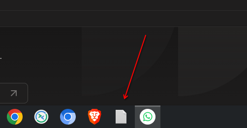

# fix-launcher-icons

Repairs blank / generic icons in the KDE Plasma task manager.



A pinned app shows its proper icon while it's running (the window supplies it),
then turns into a blank page once you close it, because Plasma falls back to
the launcher's `Icon=` — and that's broken. This script finds and fixes two
common causes:

1. **Web apps from Flatpak browsers (Brave, Chrome, Edge, …).** The generated
   `.desktop` files point `Icon=` at the browser's sandbox
   (`~/.var/app/com.brave.Browser/data/icons/…`), but the icons are actually
   installed to `~/.local/share/icons`. The file doesn't exist, so there's no
   icon. The script rewrites `Icon=` to the installed icon's name.
2. **Pins that point at a program instead of a launcher.** Dragging a
   binary onto the panel pins e.g. `file:///usr/lib/vmware/bin/vmware`, which has
   no icon. The script swaps the pin for the matching launcher
   (`vmware-workstation.desktop`).

It only touches your own files (`~/.local/share/applications` and Plasma's panel
config), shows you every change before making it, and backs up anything it
edits.

## Install

```sh
curl -Lo ~/.local/bin/fix-launcher-icons \
  https://raw.githubusercontent.com/eccieshd/fix-launcher-icons/main/fix-launcher-icons
chmod +x ~/.local/bin/fix-launcher-icons
```

Requires bash, coreutils, findutils and awk. Tested on Fedora 44 with
Plasma 6.7 on Wayland.

## Use

```sh
fix-launcher-icons            # show what's wrong, ask before fixing
fix-launcher-icons --dry-run  # only show
fix-launcher-icons --yes      # fix without asking
```

Fixing a pin restarts the Plasma panel (it rewrites its config on exit, so the
edit has to happen while it's stopped). Your panel will blink for a second.

### Keep it fixed

Browsers rewrite their web app launchers when an app is reinstalled or updated,
which brings the broken path back. To fix icons automatically whenever that
happens:

```sh
fix-launcher-icons --install     # copies itself to ~/.local/bin, enables a systemd user path unit
fix-launcher-icons --uninstall
```

The watcher only fixes icons; it never touches your panel.

### Undo

```sh
fix-launcher-icons --list-backups
fix-launcher-icons --restore           # latest backup
fix-launcher-icons --restore DIR       # a specific one
```

Backups live in `~/.local/state/fix-launcher-icons/`.

## What it won't do

- Edit launchers outside your home directory. Broken system launchers are
  reported, not changed.
- Guess. If a pinned program matches more than one launcher, or a missing icon
  has no installed replacement, it tells you and leaves it alone.
- Fix web app windows grouping under the main browser icon. That's a different
  bug (`StartupWMClass`); see
  [flathub/com.brave.Browser#894](https://github.com/flathub/com.brave.Browser/issues/894).

## Licence

MIT
